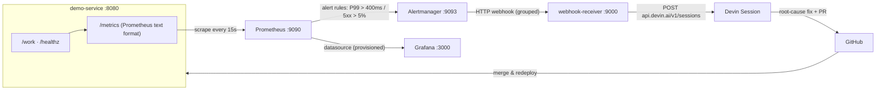
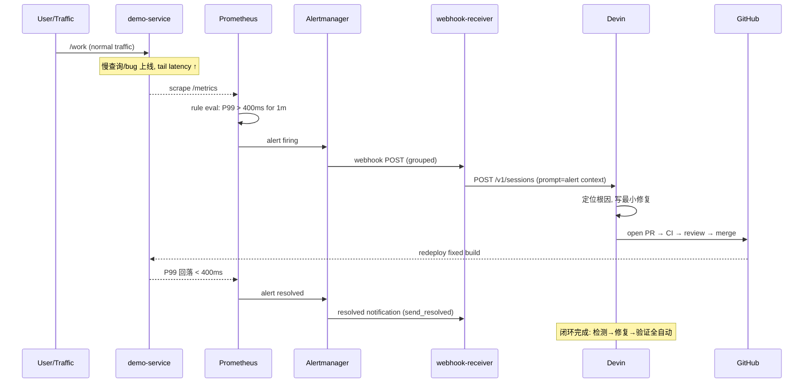

# go-prometheus-aiops-poc

最小可跑的 **AIOps 监控闭环 POC**：一个零依赖 Go HTTP 服务暴露 Prometheus 指标 →
Prometheus 按 **P99 延迟 / 5xx 错误率**触发告警 → Alertmanager 通过 **Webhook**
把告警推给接收器 → 接收器自动创建 **Devin Session** 定位并修复问题 → 修复合并、
指标恢复、告警 Resolved —— 形成完整的 **"监控 → 告警 → 自动修复"** 闭环。

> 这是 POC/教学项目，不是生产方案。每个组件都刻意保持最小，方便逐层理解。
> 生产化改造清单见文末 Roadmap。

## 架构总览



数据流两个方向：**下行**是指标采集与告警（拉模型 + 推模型），**上行**是修复闭环
（事件驱动）。Devin Session 是唯一具备写权限的节点，也是最小权限原则的重点约束对象。

## 组件清单

| 组件 | 镜像/构建 | 端口 | 职责 |
|---|---|---|---|
| demo-service | `./Dockerfile`（Go 1.23, 零依赖） | 8080 | 被监控对象：`/work` 模拟业务请求，`/metrics` 暴露指标 |
| Prometheus | `prom/prometheus:v2.55.1` | 9090 | 抓取指标、评估告警规则、推送告警到 Alertmanager |
| Alertmanager | `prom/alertmanager:v0.27.0` | 9093 | 告警分组/去重/路由，Webhook 投递 |
| webhook-receiver | `./Dockerfile`（同一镜像） | 9000 | 接收告警、记录日志、按需创建 Devin Session |
| Grafana | `grafana/grafana:11.3.0` | 3000 | 可视化，datasource + dashboard 全部 provisioning |

## Go 监控指标

demo-service 用 **RED 方法**（Rate / Errors / Duration）暴露三类指标，全部手写
Prometheus text exposition format（v0.0.4），`go.mod` 无任何外部依赖：

| 指标 | 类型 | 标签 | 说明 |
|---|---|---|---|
| `demo_http_requests_total` | counter | `handler`, `code` | 请求总量，按 handler × 状态码细分 |
| `demo_http_request_duration_seconds` | histogram | `handler`, `le` | 延迟分布，bucket 对齐 `prometheus.DefBuckets` |
| `demo_http_requests_in_flight` | gauge | — | 当前并发处理中的请求数 |

设计要点：

- **Histogram 而非 summary**：分位数由 Prometheus 服务端用 `histogram_quantile`
  计算，可跨实例聚合（客户端 summary 的 quantile 不可聚合——这是最常见的坑）。
- **Bucket 对齐 `DefBuckets`**（0.005s ~ 10s）：覆盖从毫秒级健康检查到秒级慢请求。
- **低基数标签**：只用 `handler`/`code` 两个 bounded label；绝不把 path、user_id、
  trace_id 放进标签（unbounded cardinality 会撑爆 TSDB）。
- **中间件埋点**：`instrument()` 包装 handler，延迟统计和业务代码解耦。
- 生产环境不要手搓 exposition——换 `prometheus/client_golang` 的
  `promhttp` + `promauto`，还能免费拿到 exemplars 和 Go runtime metrics。

## P99 延迟告警

核心规则（`deploy/prometheus/alerts.yml`）：

```promql
histogram_quantile(0.99, sum(rate(demo_http_request_duration_seconds_bucket{handler="/work"}[5m])) by (le)) > 0.4
```

逐层拆解：

1. `rate(..._bucket[5m])` — 对每个 `le` bucket 求每秒增长率。5 分钟窗口平衡了
   灵敏度和平滑度。
2. `sum(...) by (le)` — 把所有非 `le` 标签聚合掉。`histogram_quantile` 要求
   输入只剩 `le` 这一个维度，否则结果错乱。
3. `histogram_quantile(0.99, ...)` — 在 bucket 间线性插值，估出 P99。
4. `> 0.4` + `for: 1m` — P99 超过 400ms 且持续 1 分钟才告警，避免毛刺误报；
   `keep_firing_for: 1m` 防止告警在阈值附近抖动 flap。

为什么盯 **P99 而不是平均值**：平均值会被大量快请求稀释——1% 的用户等了 10 秒，
avg 可能毫无变化，但那一小撮人已经在骂了。尾部延迟才是真实体验。

配套还有一条 `DemoServiceHighErrorRate`（5xx 占比 > 5%），severity=warning，
展示同一条管道同时承载不同严重度的告警。

## Webhook 报警管道

```
Prometheus ──(pending→firing)──▶ Alertmanager ──(group_wait 10s→grouped POST)──▶ webhook-receiver
```

- **group_by: `alertname` + `service`**：同一条规则的多个实例告警合并成一条通知，
  Devin 收到的是"这个服务 P99 高了"，而不是 N 条重复事件。
- **group_wait 10s / group_interval 1m / repeat_interval 1h**：首个告警等 10s
  看有没有同伴；组内更新间隔 1m；未恢复的告警每小时重复提醒一次。
- **send_resolved: true**：恢复通知也会投递——闭环的"合上"就靠它确认。
- Payload 是 Alertmanager v4 格式（`alerts[]` 带 `status/labels/annotations/
  fingerprint`），receiver 原样落日志并保留最近 50 条供 `GET /alerts` 查询。

## Devin 自动化闭环

当告警 `status=firing` 且 `DEVIN_API_KEY` 已配置，receiver 调用
`POST https://api.devin.ai/v1/sessions` 创建一个 Devin Session，prompt 携带
告警名、severity、summary/description、起始时间和 generator URL：

```text
A Prometheus alert is firing: DemoServiceHighP99Latency (severity: critical).
Summary: demo-service /work P99 latency > 400ms for 1m
...
Investigate the latency/error regression behind this alert, find the root cause
in the repository, fix it with a minimal change, and open a PR.
```

完整闭环时序：



关键设计：告警 **fingerprint** 天然可做幂等——同一告警重复投递时应按
fingerprint 去重，避免一个告警开出 N 个 Devin session（当前 POC 未实现，
见 Roadmap）。

## 防误判与防死循环

自动触发一个有代码写权限的 Agent，最大的两个风险是**误报**（告警不值得修）
和**死循环**（修了没好 → 再触发 → 再修）。防护分两段：

### 防误判（dispatch 之前）

- **持续期门控**：`for` + `keep_firing_for` 保证只有持续越线的告警才到达
  receiver，瞬时毛刺在 Prometheus 层就被滤掉。
- **severity 分级路由**：只有 `severity=critical` 自动派 Devin；`warning`
  只落日志/进工单队列，由人工决定是否立案（对应 Roadmap 的多 receiver 路由）。
- **prompt 自带验证指令**：发给 Devin 的 prompt 明确要求先复现指标回归再动
  代码——指标如果已经健康，session 输出 false-positive 报告而不是硬开一个 PR。
- **fingerprint 幂等去重**：同一 fingerprint 在冷却窗口内只开一个 session，
  Alertmanager 的 `group_interval`/`repeat_interval` 重投不产生重复工单。

### 防死循环（dispatch 之后）

- **熔断器**：同一 fingerprint 每小时限 N 个 session；修复合并后告警仍
  firing → 不再自动派单，升级人工处理。
- **PR 不自动合并**：Devin 的产出是 PR 而不是 hotfix——CI + human review 是
  硬门，烂修复根本进不了 prod，循环链路被物理剪断。
- **明确终态**：`send_resolved` 通知回到 receiver 确认闭环收口；未恢复的
  告警靠 `repeat_interval` 提醒人工，而不是无限重复创建 session。

### 一个真实故障场景（这套东西修什么）

某次上线把列表查询改成 N+1（ORM eager load 丢了）：p50 纹丝不动，P99 从
80ms 涨到 600ms，1% 的请求卡到秒级——avg 告警完全瞎掉。本栈的链路是：
`histogram_quantile` 告警 firing → webhook 把 alertname + fingerprint +
summary 交给 Devin → session 对照最近 diff 定位到查询改动 → 恢复 eager
load 开 PR → 人工合并 → P99 回落 → resolved 通知收口。
**这套系统的价值不在"自动修"，在于把 P99 回归从"用户投诉驱动"变成
"指标驱动 + 自动立案"。**

## 最小权限原则

闭环里最危险的一步是"告警自动触发一个有代码写权限的 Agent"。权限收敛：

| 凭据/端点 | 授予 | 不授予 |
|---|---|---|
| Devin API key | 仅创建 session（自定义 role 只勾 `UseDevinSessions`）；存 org secret，不写进 compose/git | 组织管理、计费、secret 管理权限 |
| GitHub PAT（Devin 提 PR 用） | fine-grained PAT，仅目标仓库：`Contents: RW` + `Pull requests: RW`（Metadata 自动附带只读） | `Administration`、Actions 写、其他仓库、`repo` 全权 scope |
| webhook-receiver | 只暴露 `/alerts` `/healthz`；生产加 HMAC 签名验证 + 内网 only | 公网暴露、无鉴权接收（否则任何人可伪造告警狂刷 API 额度） |
| Grafana | anonymous = `Viewer`（只读），admin 密码不入库 | Editor/Admin 匿名角色 |
| 容器 | `USER app`（非 root），配置文件 `:ro` 只读挂载 | root 运行、可写挂载 |
| compose | 无硬编码 secret，`DEVIN_API_KEY` 仅运行时注入 | `.env`/`docker-compose.yml` 里存真 key |

一句话：**每个凭据只做它该做的一件事，泄漏后的爆炸半径最小。**

## 快速开始

```bash
# 1. 拉起整个栈
docker compose up -d --build

# 2. 打开面板
open http://localhost:3000      # Grafana（匿名 Viewer，免登录）
open http://localhost:9090      # Prometheus
open http://localhost:9093      # Alertmanager
curl http://localhost:8080/metrics   # 原始指标

# 3. （可选）接入 Devin 自动修复
DEVIN_API_KEY=<your-key> docker compose up -d webhook-receiver
```

**手动触发告警**：内置 loadgen 已经混入 ~4% 慢请求，P99 告警通常 2-3 分钟内
自己 firing。想立刻触发：

```bash
for i in $(seq 1 50); do curl -s "http://localhost:8080/work?mode=slow" & done; wait
```

观察链路：Prometheus `Alerts` 页 → `docker compose logs -f webhook-receiver` →
（如配置了 key）Devin 控制台出现新 session → 修复合并 → 告警 Resolved。

## 验证闭环 checklist

- [ ] `curl localhost:8080/metrics` 有 `demo_http_request_duration_seconds_bucket`
- [ ] Grafana dashboard 有流量曲线（loadgen 自动产生）
- [ ] `Alerts` 页 `DemoServiceHighP99Latency` 状态 firing
- [ ] `docker compose logs webhook-receiver` 出现 `alert status=firing`
- [ ] Devin session 被创建并产出 PR
- [ ] 修复部署后 P99 回落，收到 `status=resolved` 通知

## 目录结构

```
├── cmd/
│   ├── demo-service/main.go       # 被监控的 Go 服务 + /metrics exposition
│   └── webhook-receiver/main.go   # Alertmanager webhook → Devin session
├── deploy/
│   ├── prometheus/                # scrape 配置 + 告警规则
│   ├── alertmanager/              # 路由 + webhook receiver 配置
│   └── grafana/                   # provisioning: datasource + dashboard
├── docker-compose.yml
├── Dockerfile                     # 一个镜像构建两个二进制
└── go.mod                         # 零依赖
```

## 生产化 Roadmap

- [ ] `client_golang` 替换手搓 exposition（exemplars、runtime metrics）
- [ ] 按 alert `fingerprint` 幂等去重，防止重复创建 Devin session
- [ ] Webhook HMAC 签名验证 + Alertmanager `http_config` 带 Authorization
- [ ] Dead man's switch：Receiver 挂了也要有人知道（`Watchdog` 告警）
- [ ] Alert 分级路由：critical→Devin，warning→Slack/工单
- [ ] SLO 多窗口燃烧率告警（multi-burn-rate）替代单阈值
- [ ] e2e 测试：kind/compose CI job 验证告警→webhook 投递链路

## License

MIT — 拿去改，拿去学。
